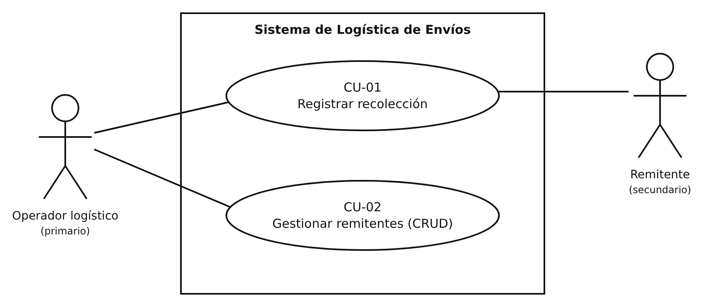
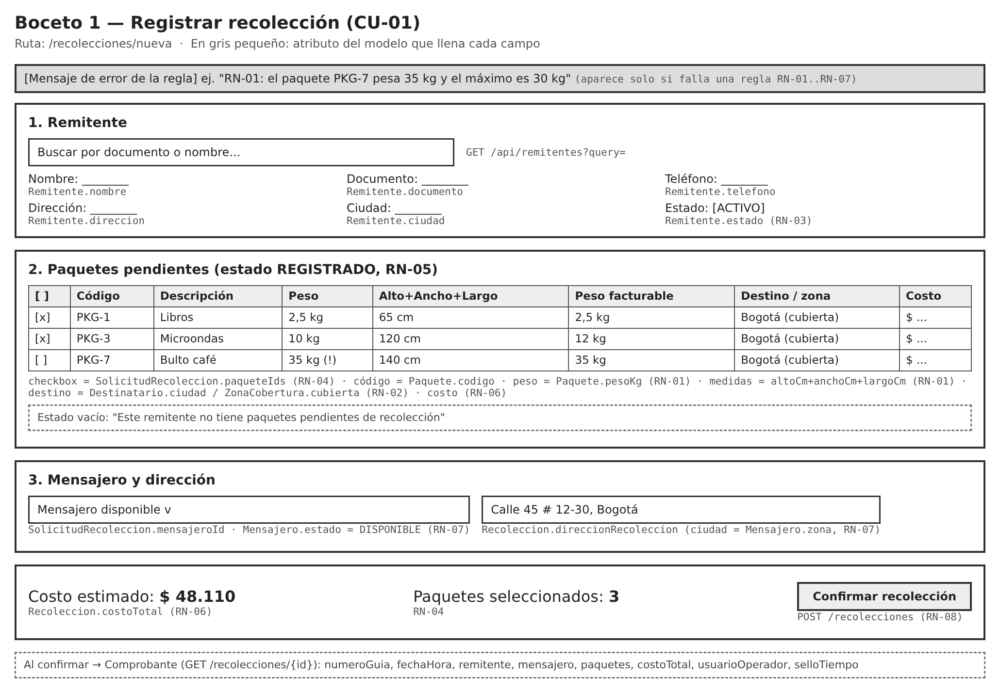
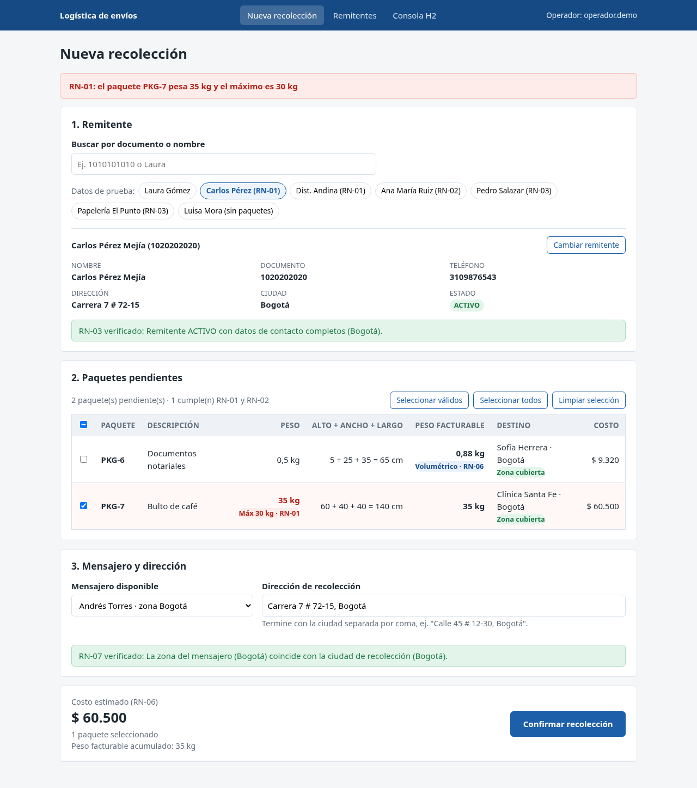
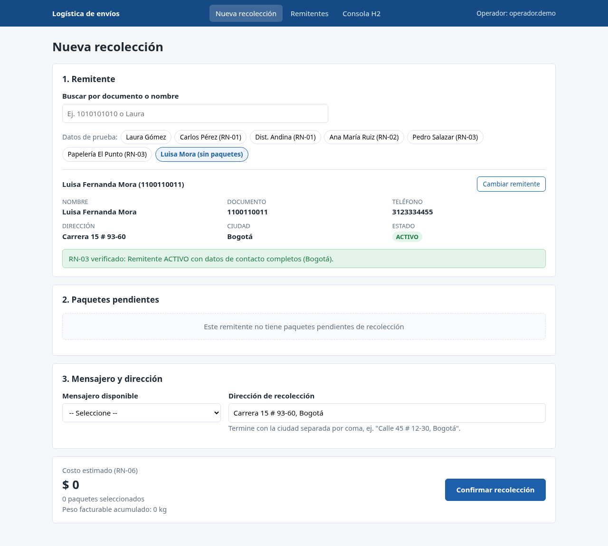
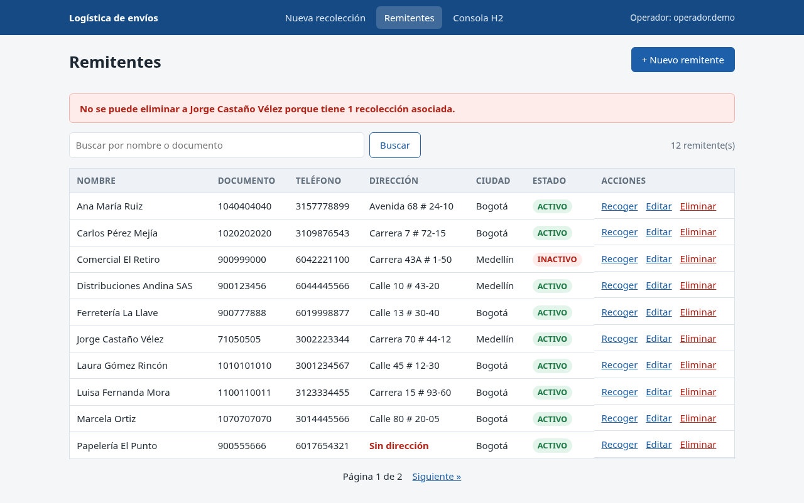
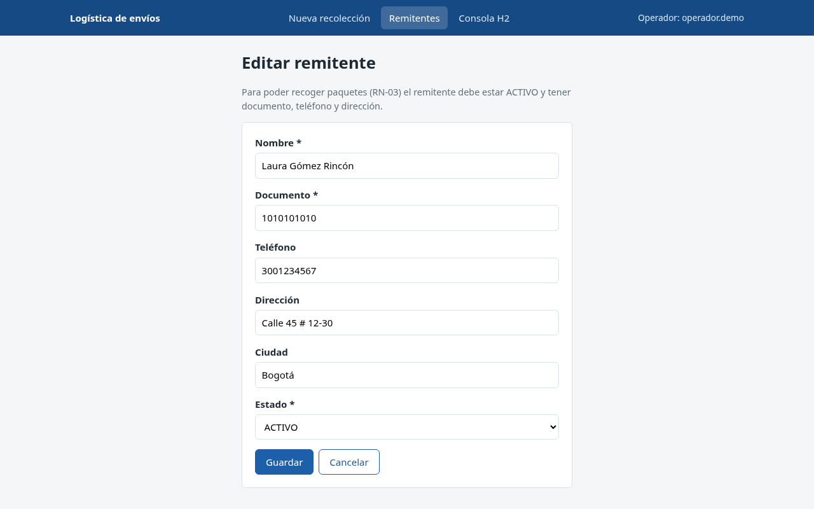
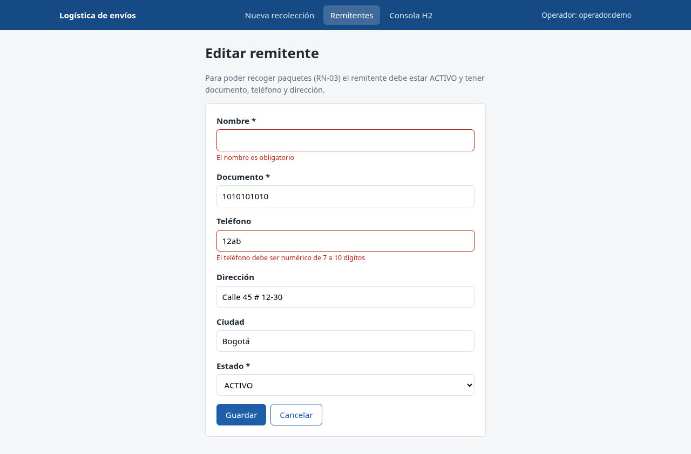

<div class="portada">

Facultad de Ingeniería<br>
Programa de Ingeniería de Sistemas y Computación<br>
Curso: Ingeniería de Software I — 2025-2

<br><br>

**PROYECTO GRUPAL**

**Sistema de Logística de Envíos**<br>
Escenario 9, Variante A: Registrar Recolección (Paquete, Remitente, Recolección)

<br><br>

Integrantes:<br>
Janner Alejandro Rojas Rivas

<br>

Repositorio: https://github.com/Rojasthepro/logistica-envios

Noviembre de 2026

</div>

## Contenido

1. Modelo de dominio
2. Requisitos y reglas de negocio
3. Casos de uso
4. Diagrama de secuencia
5. Diagrama de actividad
6. Prototipo
7. Implementación del MVP
8. Matriz de trazabilidad
9. Prueba de concepto: datos y casos de aceptación

**Resumen.** La transacción de negocio es *Registrar Recolección*: el operador elige un remitente, marca los paquetes que se van a recoger, asigna un mensajero y confirma. El sistema valida las reglas, calcula el costo, genera la guía y entrega un comprobante. La transacción conecta cinco entidades del dominio (Remitente, Paquete, Recolección, Mensajero y ZonaCobertura). El CRUD se hace sobre la entidad **Remitente**. El MVP tiene las dos pantallas ejecutables que pide el enunciado.

## 1. Modelo de dominio

### 1.1 Diagrama de clases


### 1.2 Asociaciones y multiplicidades

| Asociación | Multiplicidad | Significado |
|---|---|---|
| Remitente — Paquete | 1 — 0..* | Un remitente registra sus paquetes; cada paquete tiene un solo remitente. |
| Remitente — Recolección | 1 — 0..* | Un remitente puede tener varias recolecciones en el tiempo. |
| Mensajero — Recolección | 1 — 0..* | Cada recolección la hace un mensajero. |
| Recolección — Paquete | 0..1 — 1..* | Una recolección agrupa uno o más paquetes. Un paquete no tiene recolección mientras está REGISTRADO y queda con una sola cuando se recoge. |
| Paquete — Destinatario | 0..* — 1 | Cada paquete va consignado a un destinatario. |
| Destinatario — ZonaCobertura | 0..* — 1 | La zona define si hay cobertura y las tarifas. |

### 1.3 Invariantes

1. Un paquete solo puede entrar a una recolección si está en estado REGISTRADO, no tiene recolección y es del mismo remitente.
2. Todo paquete recolectado pesa máximo 30 kg y alto + ancho + largo suma máximo 150 cm.
3. Ningún paquete recolectado puede ir a una zona con `cubierta = false`.
4. Una recolección REALIZADA tiene al menos un paquete, número de guía único (GUIA-000001, GUIA-000002, …), usuarioOperador y selloTiempo.
5. Cuando una recolección queda REALIZADA, todos sus paquetes están RECOGIDO y su mensajero está EN_RUTA.

## 2. Requisitos y reglas de negocio

### 2.1 Requisitos funcionales

| ID | Requisito | Prioridad |
|---|---|---|
| RF-01 | El sistema debe permitir buscar un remitente por documento o parte del nombre y mostrar hasta 10 coincidencias. | Alta |
| RF-02 | El sistema debe mostrar los paquetes REGISTRADO sin recolección del remitente elegido, con peso, medidas, peso facturable, destino y costo; si no hay, debe mostrar "Este remitente no tiene paquetes pendientes de recolección". | Alta |
| RF-03 | El sistema debe permitir marcar uno o varios paquetes para la misma recolección. | Alta |
| RF-04 | El sistema debe permitir elegir un mensajero DISPONIBLE y la dirección de recolección. | Alta |
| RF-05 | El sistema debe calcular el costo estimado (RN-06) y actualizarlo cada vez que se marca o desmarca un paquete. | Alta |
| RF-06 | El sistema debe registrar la recolección REALIZADA, pasar los paquetes a RECOGIDO y el mensajero a EN_RUTA en una sola transacción, generar la guía y mostrar el comprobante. | Alta |
| RF-07 | El sistema debe rechazar la recolección que incumpla RN-01 a RN-05 o RN-07 sin guardar nada, mostrando el código de la regla y el motivo y conservando lo digitado. | Alta |
| RF-08 | El sistema debe listar los remitentes en páginas de 10, ordenados por nombre, con búsqueda por nombre o documento. | Alta |
| RF-09 | El sistema debe permitir crear un remitente (nombre y documento obligatorios, documento único, teléfono de 7 a 10 dígitos, estado ACTIVO o INACTIVO). | Alta |
| RF-10 | El sistema debe permitir editar un remitente con las mismas validaciones de la creación. | Alta |
| RF-11 | El sistema debe permitir eliminar un remitente previa confirmación, y rechazarlo si tiene recolecciones o paquetes asociados. | Media |

### 2.2 Requisitos no funcionales

| ID | Requisito |
|---|---|
| RNF-01 | Atomicidad: la confirmación se hace en una transacción (`@Transactional`); si una regla falla no se guarda ningún cambio. |
| RNF-02 | Validación en cliente y servidor: la pantalla avisa en vivo (peso, cobertura, zona del mensajero, remitente inactivo), pero la decisión final la toma el backend. |
| RNF-03 | Rendimiento: con los datos de prueba, la búsqueda de remitentes y la confirmación responden en menos de 1 segundo en un equipo de desarrollo. |
| RNF-04 | Accesibilidad básica: todos los campos tienen etiqueta, los errores se muestran en texto (no solo con color) y la interfaz funciona con teclado. |

### 2.3 Reglas de negocio

| Regla | Enunciado | Dónde se valida |
|---|---|---|
| RN-01 | Cada paquete pesa máximo 30 kg y alto + ancho + largo suma máximo 150 cm. | CU-01 FA-02 · Actividad · Interfaz (aviso en la fila) · Backend `validarPesoYMedidas` |
| RN-02 | La zona del destinatario de cada paquete debe tener cobertura. | CU-01 FA-03 · Actividad · Interfaz (etiqueta "Sin cobertura") · Backend `validarCoberturaDestinos` |
| RN-03 | El remitente debe estar ACTIVO y tener documento, teléfono y dirección. | CU-01 FA-01 · Actividad · Interfaz (aviso al elegirlo) · Backend `validarRemitenteHabilitado` |
| RN-04 | La recolección debe tener al menos un paquete. | CU-01 FA-06 · Actividad · Interfaz (contador) · Backend `validarAlMenosUnPaquete` |
| RN-05 | Solo se recogen paquetes REGISTRADO, sin recolección y del mismo remitente. | CU-01 FA-04 · Actividad · Interfaz (solo lista pendientes) · Backend `validarPaquetesPendientes` |
| RN-06 | Costo = Σ (tarifaBase de la zona + pesoFacturable × valorPorKg), con pesoFacturable = máx(pesoKg, alto × ancho × largo / 5000). | CU-01 paso 7 · Actividad · Interfaz (costo estimado) · Backend `calcularCostoTotal` |
| RN-07 | El mensajero debe estar DISPONIBLE y su zona debe ser la ciudad de la dirección de recolección. | CU-01 FA-05 · Actividad · Interfaz (aviso de zona) · Backend `validarMensajeroAsignable` |
| RN-08 | Cada recolección recibe una guía consecutiva GUIA-XXXXXX y guarda usuarioOperador y selloTiempo. | CU-01 paso 10 · Actividad · Comprobante · Backend `registrarGuiaYTrazabilidad` |

## 3. Casos de uso



### 3.1 CU-01 Registrar recolección (caso de uso estrella)

| | |
|---|---|
| **Actores** | Operador logístico (primario), Remitente (secundario: entrega los paquetes) |
| **Precondiciones** | El remitente está registrado. Hay mensajeros DISPONIBLE. El operador está en la pantalla Nueva recolección. |
| **Postcondición de éxito** | Existe una recolección REALIZADA con guía, costo, usuarioOperador y selloTiempo; sus paquetes quedan RECOGIDO y el mensajero EN_RUTA; se muestra el comprobante. |
| **Postcondición de fallo** | No se guarda ningún cambio y se muestra el mensaje de la regla que falló, conservando lo digitado. |

**Flujo básico**

1. El operador escribe el documento o el nombre del remitente.
2. El sistema muestra las coincidencias (RF-01) y el operador elige una.
3. El sistema muestra los datos del remitente y sus paquetes pendientes (RF-02, RN-05).
4. El operador marca los paquetes que se van a recoger (RF-03).
5. El operador elige un mensajero disponible y revisa la dirección de recolección (RF-04).
6. El operador pulsa **Confirmar recolección**.
7. El sistema valida en orden RN-03, RN-04, RN-05, RN-01, RN-02 y RN-07, y calcula el costo total (RN-06).
8. El sistema crea la recolección REALIZADA.
9. El sistema pasa los paquetes a RECOGIDO y el mensajero a EN_RUTA.
10. El sistema genera la guía y registra usuarioOperador y selloTiempo (RN-08).
11. El sistema muestra el comprobante de la recolección.

**Flujos alternos**

| ID | Paso | Condición | Respuesta del sistema |
|---|---|---|---|
| FA-01 | 3 y 7 | Remitente INACTIVO o sin documento, teléfono o dirección (RN-03) | Al elegirlo muestra una advertencia; al confirmar rechaza: "RN-03: el remitente Pedro Salazar está INACTIVO y solo se recoge a remitentes ACTIVO". |
| FA-02 | 7 | Un paquete pesa más de 30 kg o mide más de 150 cm (RN-01) | "RN-01: el paquete PKG-7 pesa 35 kg y el máximo es 30 kg". |
| FA-03 | 7 | Un destino está en zona sin cobertura (RN-02) | "RN-02: el paquete PKG-8 va para Rosa Tikuna en la zona Leticia, que no tiene cobertura". |
| FA-04 | 3 y 7 | El remitente no tiene paquetes pendientes, o un paquete ya fue recogido o es de otro remitente (RN-05) | Muestra el estado vacío "Este remitente no tiene paquetes pendientes de recolección"; al confirmar un paquete no válido, rechaza con RN-05. |
| FA-05 | 7 | El mensajero no está DISPONIBLE o su zona no es la ciudad de la dirección (RN-07) | "RN-07: el mensajero Felipe Mora cubre la zona Medellín y la recolección es en Bogotá". |
| FA-06 | 7 | No se marcó ningún paquete (RN-04) | "RN-04: debe seleccionar al menos un paquete". |

En todos los flujos alternos la transacción se deshace y el operador sigue en la misma pantalla con sus datos.

### 3.2 CU-02 Gestionar remitentes (caso de uso secundario)

| | |
|---|---|
| **Actor** | Operador logístico |
| **Precondición** | El operador está en la pantalla Remitentes. |
| **Postcondición de éxito** | El remitente queda creado, actualizado o eliminado y el listado lo refleja. |
| **Postcondición de fallo** | No se guarda el cambio y se muestra el motivo. |

**Flujo básico**

1. El sistema lista los remitentes en páginas de 10, ordenados por nombre (RF-08).
2. El operador puede buscar por nombre o documento.
3. El operador elige **Nuevo remitente**, **Editar** o **Eliminar**.
4. Para crear o editar, el sistema muestra el formulario: nombre, documento, teléfono, dirección, ciudad y estado.
5. El operador llena los datos y pulsa **Guardar**.
6. El sistema valida los datos (RF-09, RF-10).
7. El sistema guarda el remitente, vuelve al listado y muestra un mensaje de confirmación.
8. Para eliminar, el sistema pide confirmación y, si el operador acepta, borra el remitente (RF-11).

**Flujos alternos**

| ID | Paso | Condición | Respuesta del sistema |
|---|---|---|---|
| FA-07 | 6 | Faltan datos obligatorios, el teléfono no tiene 7 a 10 dígitos o el documento ya existe | Muestra el error junto al campo (ej. "El teléfono debe ser numérico de 7 a 10 dígitos") y conserva lo digitado. |
| FA-08 | 8 | El remitente tiene recolecciones o paquetes asociados | No lo elimina y muestra: "No se puede eliminar a Jorge Castaño Vélez porque tiene 1 recolección asociada". |
| FA-09 | 2 | La búsqueda no encuentra nada | Muestra "No se encontraron remitentes para el criterio buscado." |

## 4. Diagrama de secuencia (Sec-01)

El diagrama sigue el flujo básico de CU-01. Usa los nombres reales de clases y métodos del código. El fragmento `alt` separa el caso en que falla una regla (FA-01 a FA-06) del caso exitoso.


## 5. Diagrama de actividad (Act-01)

El diagrama tiene:

- un nodo inicial,
- una decisión por cada regla, en el mismo orden en que las valida el código,
- una sincronización (fork/join) para los tres cambios de estado que ocurren juntos,
- un nodo final para el éxito y uno para cada rechazo.


## 6. Prototipo

### 6.1 Bocetos

Los bocetos marcan, debajo de cada campo, el atributo del modelo que lo llena. También muestran el mensaje de error y el estado vacío.




### 6.2 Campos y atributos

| Pantalla | Campo / widget | Atributo o dato |
|---|---|---|
| Recolección | Buscador de remitente | `Remitente.documento`, `Remitente.nombre` → `SolicitudRecoleccion.remitenteId` |
| Recolección | Datos del remitente | `Remitente.nombre, documento, telefono, direccion, ciudad, estado` |
| Recolección | Tabla de paquetes (checkbox) | `SolicitudRecoleccion.paqueteIds`, `Paquete.codigo, descripcion, pesoKg, altoCm, anchoCm, largoCm` |
| Recolección | Destino y cobertura | `Destinatario.nombre, ciudad`, `ZonaCobertura.cubierta` |
| Recolección | Selector de mensajero | `SolicitudRecoleccion.mensajeroId` (`Mensajero.estado = DISPONIBLE`, `Mensajero.zona`) |
| Recolección | Dirección de recolección | `Recoleccion.direccionRecoleccion` |
| Recolección | Costo estimado | `Recoleccion.costoTotal` (RN-06) |
| Comprobante | Encabezado | `Recoleccion.numeroGuia, fechaHora, estado, usuarioOperador, selloTiempo` |
| Remitentes | Tabla y formulario | `Remitente.nombre, documento, telefono, direccion, ciudad, estado` |

### 6.3 Pantallas implementadas

El prototipo navegable se hizo directamente en HTML con Thymeleaf. Las capturas son de la aplicación funcionando con los datos de prueba.


**Pantalla 1, caso feliz:** Laura Gómez con PKG-1, PKG-2 y PKG-3, costo estimado de $ 48.110.



**Pantalla 1, error de regla:** Carlos Pérez con PKG-7 de 35 kg. El mensaje aparece arriba y la selección se conserva.



**Pantalla 1, estado vacío:** Luisa Fernanda Mora no tiene paquetes pendientes.


**Comprobante de la recolección.**


**Pantalla 2, listado paginado de remitentes.**



**Pantalla 2, eliminación bloqueada:** Jorge Castaño tiene una recolección.



**Pantalla 2, formulario de edición.**



**Pantalla 2, errores de validación junto a cada campo.**

## 7. Implementación del MVP

**Tecnología:** Java 17+, Spring Boot 3.5, Spring Data JPA, Thymeleaf, base de datos H2 en memoria, Maven Wrapper.

**Cómo correrlo**

```
./mvnw spring-boot:run
```

| Ruta | Qué hay |
|---|---|
| http://localhost:8080/recolecciones/nueva | Pantalla 1: transacción Registrar recolección |
| http://localhost:8080/remitentes | Pantalla 2: CRUD de remitentes |
| http://localhost:8080/h2-console | Consola de la BD (JDBC `jdbc:h2:mem:logistica`, usuario `sa`, sin contraseña) |

No hay inicio de sesión. El usuario demo es `operador.demo` y es el que queda registrado en cada recolección (RN-08).

**Endpoints**

| Método y ruta | Controlador | Uso |
|---|---|---|
| GET /api/remitentes?query= | ApiController.buscarRemitentes | Buscador de remitentes (RF-01) |
| GET /api/paquetes?remitenteId= | ApiController.paquetesPendientes | Paquetes pendientes con costo (RF-02, RF-05) |
| GET /recolecciones/nueva | RecoleccionController.nueva | Muestra la pantalla 1 |
| POST /recolecciones | RecoleccionController.confirmar | Valida reglas y crea la recolección (RF-06, RF-07) |
| GET /recolecciones/{id} | RecoleccionController.comprobante | Comprobante |
| GET /remitentes?q=&pagina= | RemitenteController.listar | Listado y búsqueda (RF-08) |
| GET /remitentes/nuevo · POST /remitentes | RemitenteController.nuevo / crear | Crear (RF-09) |
| GET /remitentes/{id}/editar · POST /remitentes/{id} | RemitenteController.editar / actualizar | Editar (RF-10) |
| POST /remitentes/{id}/eliminar | RemitenteController.eliminar | Eliminar (RF-11) |

Como la vista es HTML con formularios, editar y eliminar usan POST en lugar de PATCH y DELETE.

**Organización del código** (`src/main/java/com/logistica/envios`)

| Paquete | Contenido |
|---|---|
| model | Entidades JPA (Remitente, Paquete, Recoleccion, Mensajero, Destinatario, ZonaCobertura) y enums de estado |
| repository | Repositorios Spring Data JPA |
| service | RecoleccionService (un método por regla RN-01..RN-08) y RemitenteService |
| controller | RecoleccionController, RemitenteController y ApiController |
| dto | SolicitudRecoleccion, RemitenteResumen, PaqueteResumen |
| exception | NegocioException (lleva el código de la regla) |

## 8. Matriz de trazabilidad

Requisito → Caso de uso → Diagrama → Widget del prototipo → Endpoint / Controlador.

| Req. | Caso de uso | Diagrama | Widget | Endpoint / controlador |
|---|---|---|---|---|
| RF-01 | CU-01 pasos 1–2 | Act-01 inicio · Sec-01 msj. 1–4 | Buscador de remitente | GET /api/remitentes · ApiController.buscarRemitentes |
| RF-02 | CU-01 paso 3 · FA-04 | Act-01 "¿Tiene paquetes pendientes?" · Sec-01 msj. 6–9 | Tabla de paquetes · estado vacío | GET /api/paquetes · ApiController.paquetesPendientes |
| RF-03 | CU-01 paso 4 · FA-06 | Act-01 decisión RN-04 · Sec-01 msj. 16 | Checkbox por paquete · contador | POST /recolecciones · RecoleccionService.validarAlMenosUnPaquete |
| RF-04 | CU-01 paso 5 · FA-05 | Act-01 decisión RN-07 · Sec-01 msj. 21 | Selector de mensajero · campo dirección | POST /recolecciones · RecoleccionService.validarMensajeroAsignable |
| RF-05 | CU-01 paso 7 | Act-01 "Calcular costo total" · Sec-01 msj. 9 y 24 | Costo estimado | GET /api/paquetes · RecoleccionService.calcularCostoTotal |
| RF-06 | CU-01 pasos 8–11 | Act-01 fork/join y fin · Sec-01 msj. 24–32 | Botón Confirmar · comprobante | POST /recolecciones · GET /recolecciones/{id} · RecoleccionController.confirmar / comprobante |
| RF-07 | CU-01 FA-01 a FA-06 | Act-01 ramas "No" · Sec-01 fragmento alt | Mensaje de error de la regla | POST /recolecciones · RecoleccionController.confirmar (captura NegocioException) |
| RF-08 | CU-02 pasos 1–2 · FA-09 | — | Tabla, buscador y paginador | GET /remitentes · RemitenteController.listar |
| RF-09 | CU-02 pasos 3–7 · FA-07 | — | Botón Nuevo remitente · formulario | POST /remitentes · RemitenteController.crear |
| RF-10 | CU-02 pasos 3–7 · FA-07 | — | Enlace Editar · formulario | POST /remitentes/{id} · RemitenteController.actualizar |
| RF-11 | CU-02 paso 8 · FA-08 | — | Botón Eliminar · mensaje de motivo | POST /remitentes/{id}/eliminar · RemitenteController.eliminar |

**Regla → método → prueba**

| Regla | Método | Prueba |
|---|---|---|
| RN-01 | validarPesoYMedidas | CA-01 · prueba automática |
| RN-02 | validarCoberturaDestinos | CA-02 · prueba automática |
| RN-03 | validarRemitenteHabilitado | CA-03 · prueba automática |
| RN-04 | validarAlMenosUnPaquete | CA-07 (demo) |
| RN-05 | validarPaquetesPendientes | CA-05 (demo) |
| RN-06 | calcularCostoTotal, calcularPesoFacturable | CA-04 · prueba automática |
| RN-07 | validarMensajeroAsignable | CA-08 (demo) |
| RN-08 | registrarGuiaYTrazabilidad, generarNumeroGuia | CA-04 · prueba automática |

Los diagramas de actividad y secuencia modelan solo la transacción, como pide el enunciado. Por eso los requisitos del CRUD (RF-08 a RF-11) no tienen diagrama.

## 9. Prueba de concepto: datos y casos de aceptación

### 9.1 Datos de prueba (`data.sql`)

Se cargan solos al arrancar la aplicación.

| Entidad | Registros | Casos que cubren |
|---|---|---|
| Remitente | 12 | 10 activos y 2 inactivos. Pedro Salazar es INACTIVO (RN-03), Papelería El Punto no tiene dirección (RN-03) y Luisa Fernanda Mora no tiene paquetes (estado vacío). |
| Paquete | 20 | PKG-7 de 35 kg y PKG-5 de 160 cm (RN-01), PKG-8 a Leticia y PKG-15 a Mitú (RN-02), PKG-10 ya RECOGIDO (RN-05) y PKG-3 cobrado por peso volumétrico (RN-06). |
| Mensajero | 5 | 4 DISPONIBLE en Bogotá y Medellín, y Sandra Ríos EN_RUTA. |
| Destinatario | 8 | En Bogotá, Medellín, Leticia y Mitú. |
| ZonaCobertura | 4 | Bogotá y Medellín cubiertas; Leticia y Mitú sin cobertura. |
| Recolección | 1 | GUIA-000001, para que la siguiente guía sea GUIA-000002. |

### 9.2 Casos de aceptación (Given-When-Then)

| ID | Dado (Given) | Cuando (When) | Entonces (Then) |
|---|---|---|---|
| CA-01 | Carlos Pérez tiene el paquete PKG-7 de 35 kg | se confirma una recolección con PKG-7 | se muestra "RN-01: el paquete PKG-7 pesa 35 kg y el máximo es 30 kg", no se crea la recolección y PKG-7 sigue REGISTRADO |
| CA-02 | PKG-8 va para Leticia, zona sin cobertura | se confirma una recolección con PKG-8 | se rechaza con RN-02 y no se guarda nada |
| CA-03 | Pedro Salazar está INACTIVO | se confirma una recolección suya | se rechaza con "RN-03: el remitente Pedro Salazar está INACTIVO y solo se recoge a remitentes ACTIVO" |
| CA-04 | Laura Gómez tiene PKG-1, PKG-2 y PKG-3 pendientes y Andrés Torres está disponible en Bogotá | se marcan los tres paquetes y se confirma | se crea GUIA-000002 por $ 48.110, los paquetes quedan RECOGIDO, Andrés Torres EN_RUTA y se guarda operador.demo con el sello de tiempo |
| CA-05 | Jorge Castaño tiene PKG-10 ya RECOGIDO | se elige a Jorge Castaño | PKG-10 no aparece en la lista de pendientes (RN-05) |
| CA-06 | Jorge Castaño tiene una recolección | se intenta eliminarlo en el CRUD | se muestra "No se puede eliminar a Jorge Castaño Vélez porque tiene 1 recolección asociada" y sigue en el listado |
| CA-07 | se eligió a Laura Gómez | se confirma sin marcar paquetes | se muestra "RN-04: debe seleccionar al menos un paquete" |
| CA-08 | Felipe Mora es de Medellín y la dirección es en Bogotá | se confirma con Felipe Mora | se rechaza con "RN-07: el mensajero Felipe Mora cubre la zona Medellín y la recolección es en Bogotá" |

### 9.3 Pruebas automáticas

`RecoleccionServiceTest` tiene 4 pruebas en formato Given-When-Then. Cubren CA-01 a CA-04. Se ejecutan con `./mvnw test`.

| Prueba | Resultado |
|---|---|
| paqueteDe35Kg_rechazaConRN01_yNoCreaLaRecoleccion | Pasa |
| destinatarioEnZonaSinCobertura_rechazaConRN02 | Pasa |
| remitenteInactivo_rechazaConRN03 | Pasa |
| casoValido_creaRecoleccionConGuia_paquetesRecogidos_yMensajeroEnRuta | Pasa |

Resultado: 4 pruebas ejecutadas, 0 fallos, 0 errores.
