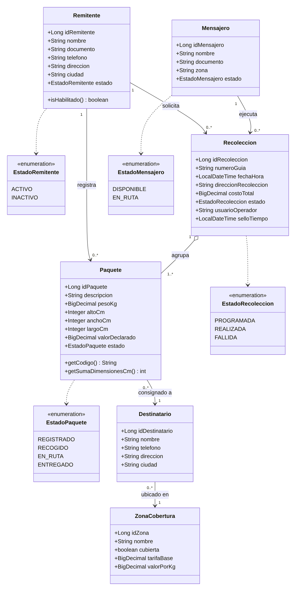
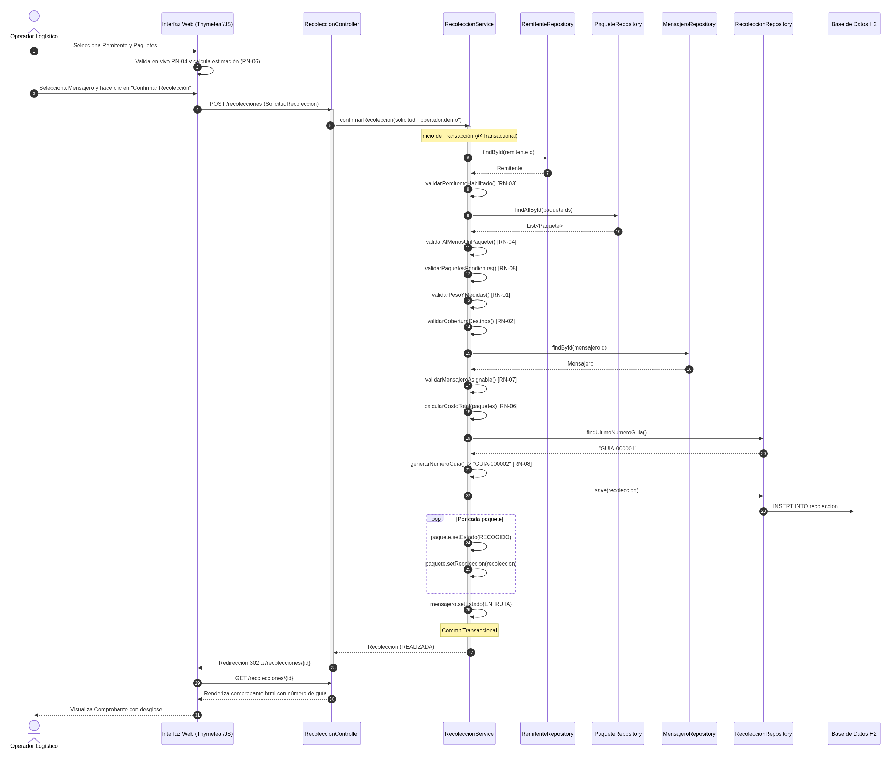
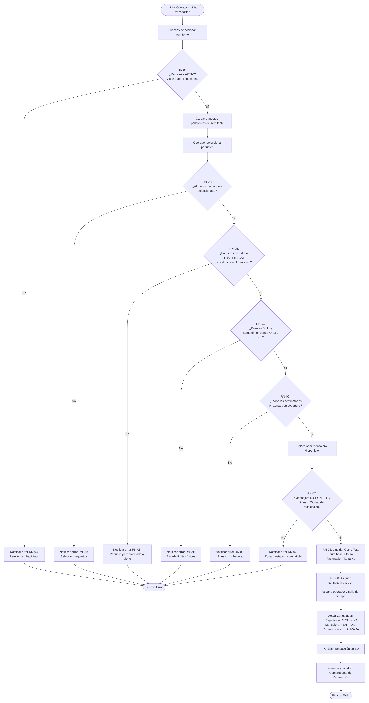
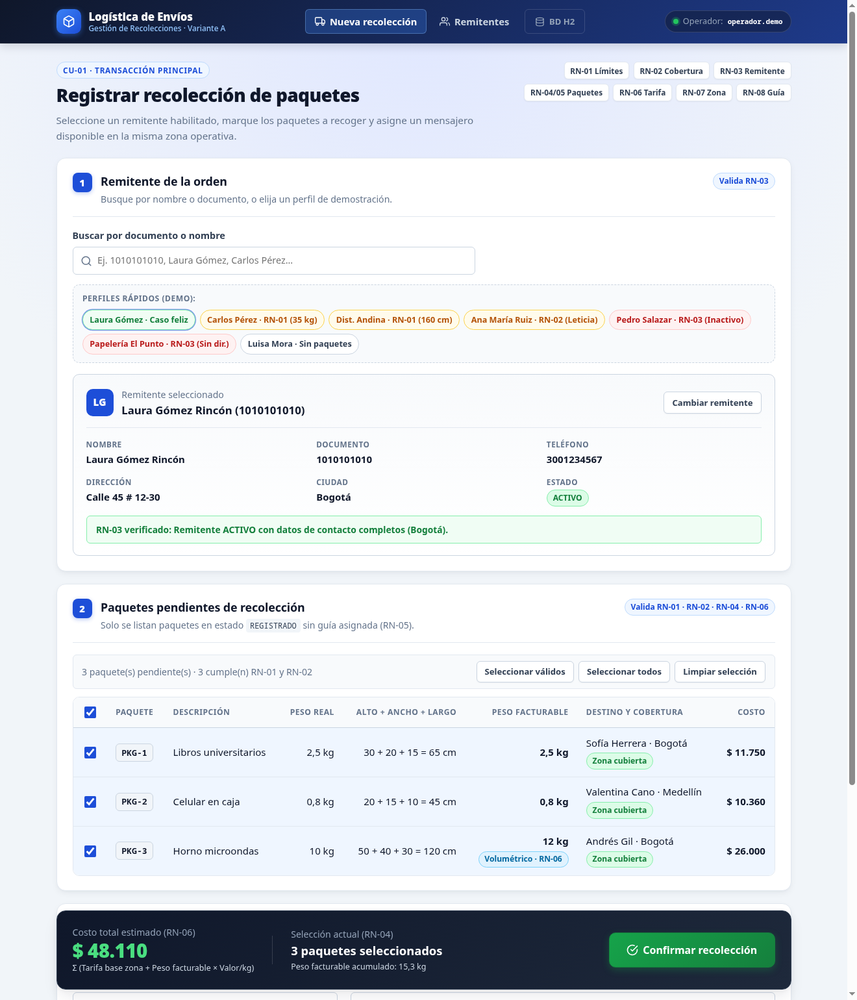
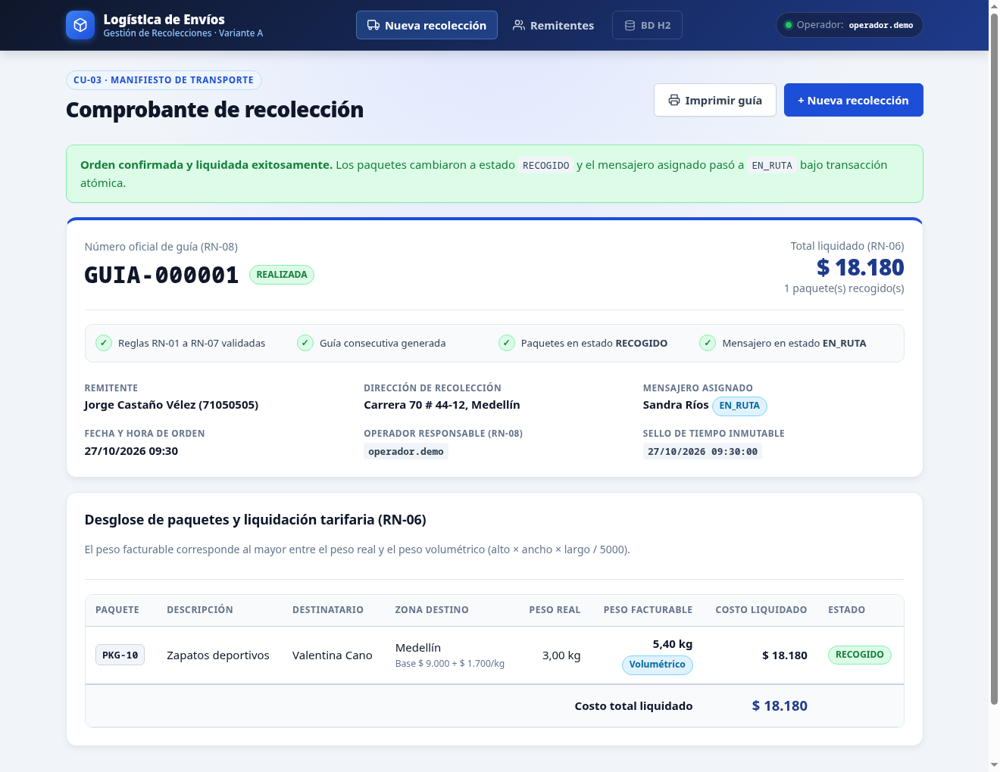
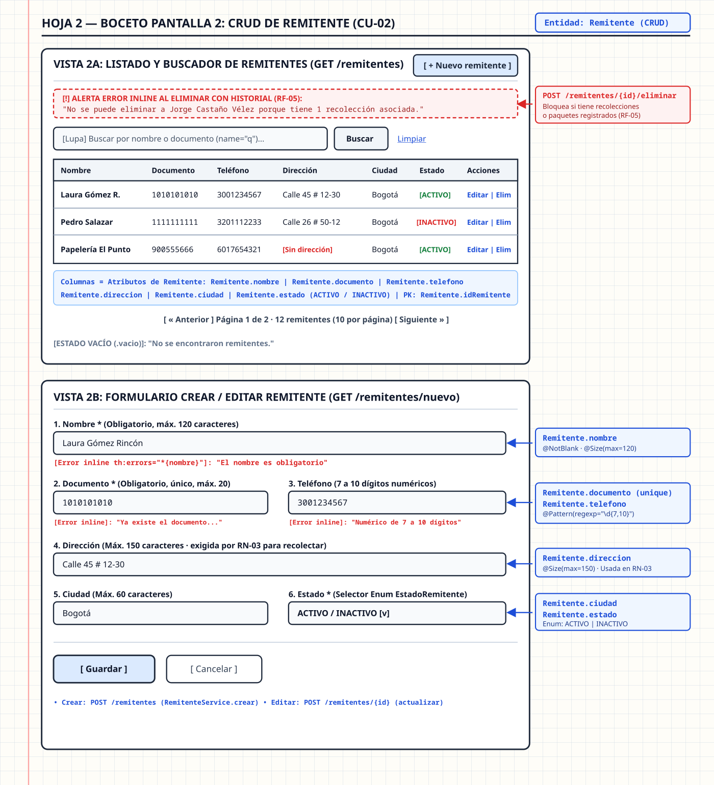
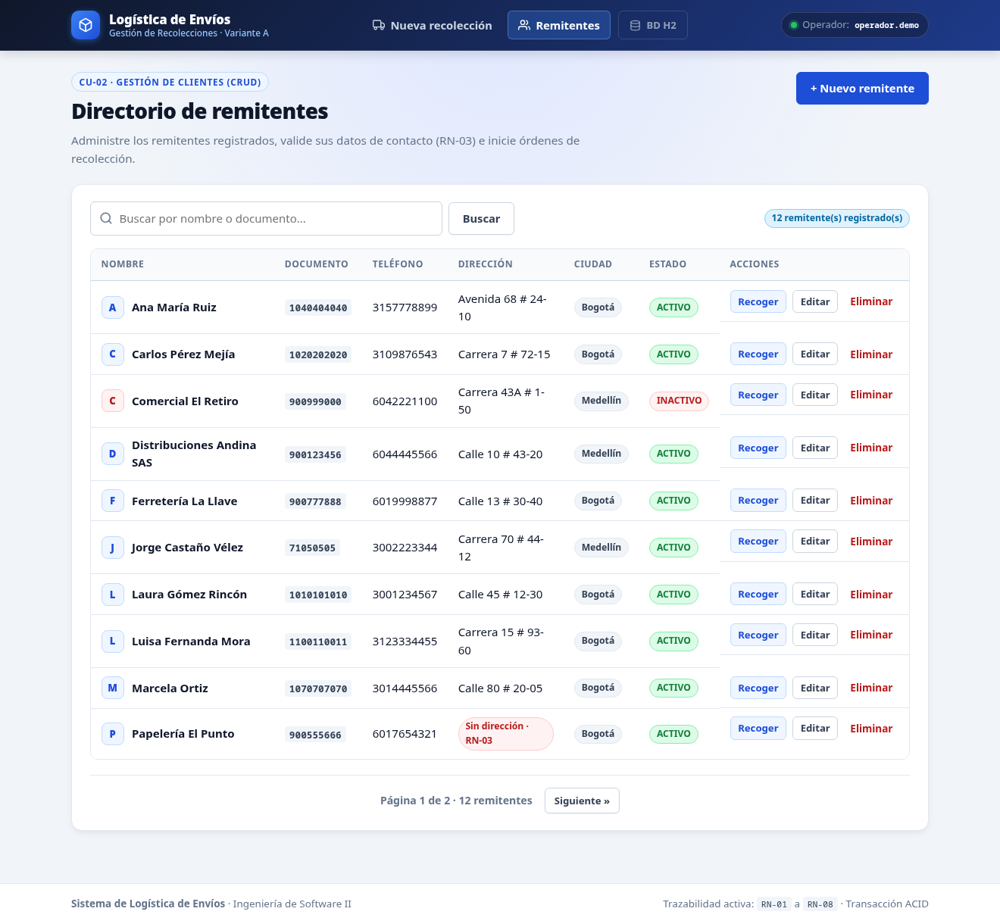

# Facultad de Ingeniería — Programa de Ingeniería de Sistemas y Computación
## Curso: Ingeniería de Software II (Octubre de 2025-2)
### Documento de Entrega — Proyecto Grupal

---

# PROYECTO GRUPAL: SISTEMA DE LOGÍSTICA DE ENVÍOS
## Variante A: Registrar Recolección de Paquetes (Paquete, Remitente, Recolección)
**Estudiante:** Janner Alejandro Rojas Rivas  
**Repositorio / Código Fuente:** [`/home/jannerr/logistica-envios`](file:///home/jannerr/logistica-envios)  
**Tecnología del MVP:** Java 17 / 21 · Spring Boot 3.5 · Spring Data JPA · Thymeleaf · Base de Datos H2 en Memoria · Maven Wrapper  

---

## 1. Modelo de Dominio (15 Puntos)

### 1.1 Diagrama de Clases UML
El modelo conecta las entidades core requeridas para la transacción de recolección, integrando la entidad del CRUD (`Remitente`) con la transacción (`Recoleccion`), el recurso transportado (`Paquete`), el actor logístico (`Mensajero`), el destino (`Destinatario`) y la parametrización tarifaria (`ZonaCobertura`).




### 1.2 Diccionario de Entidades y Multiplicidades
- **`Remitente` (1..1 — 0..\* `Paquete`):** Un remitente es dueño de sus paquetes en estado `REGISTRADO` antes de ser recolectados. Esto permite filtrar en pantalla exclusivamente los paquetes pendientes de dicho remitente.
- **`Remitente` (1..1 — 0..\* `Recoleccion`):** Un remitente puede generar múltiples solicitudes de recolección a lo largo del tiempo. Cada recolección pertenece a un único remitente.
- **`Recoleccion` (1..1 — 1..\* `Paquete`):** La transacción agrupa uno o más paquetes pendientes. Cada paquete recolectado queda vinculado a una única guía de recolección.
- **`Mensajero` (1..1 — 0..\* `Recoleccion`):** Un mensajero ejecuta la recolección física. Al confirmarse, cambia a estado `EN_RUTA`.
- **`Destinatario` (1..1 — 0..\* `Paquete`):** Cada paquete tiene un destinatario consignado con dirección y zona geográfica.
- **`ZonaCobertura` (1..1 — 0..\* `Destinatario`):** Parametriza si una ciudad cuenta con cobertura logística (`cubierta = true`) y fija la `tarifaBase` y el `valorPorKg` para la tasación.

### 1.3 Invariantes Clave del Dominio
1. **Invariante de Pertenencia Transaccional:** Un paquete solo puede ser recolectado si su estado es `REGISTRADO`, no posee recolección asignada previa y pertenece al remitente que origina la solicitud.
2. **Invariante de Capacidad Física:** Todo paquete admitido debe cumplir: $\text{pesoKg} \le 30.0$ y $(\text{altoCm} + \text{anchoCm} + \text{largoCm}) \le 150$.
3. **Invariante de Cobertura Geográfica:** Ningún paquete puede ser recolectado si la `ZonaCobertura` de su destinatario tiene `cubierta = false`.
4. **Invariante de Asignación Logística:** La zona operativa del mensajero debe coincidir de forma unívoca con la ciudad extraída de la dirección de recolección.
5. **Invariante de Trazabilidad:** Toda recolección `REALIZADA` debe poseer un número de guía autogenerado con formato `GUIA-XXXXXX`, el nombre del `usuarioOperador` y el `selloTiempo` de auditoría inmutable.

---

## 2. Requisitos y Reglas de Negocio (10 Puntos)

### 2.1 Requisitos Funcionales (RF)
- **RF-01 (Transacción - Registrar Recolección):** El sistema debe permitir registrar una recolección vinculando un remitente activo, al menos un paquete pendiente, un mensajero disponible de la misma zona y la dirección de recolección.
- **RF-02 (Cálculo de Tarifas y Peso Volumétrico):** El sistema debe liquidar automáticamente el costo total sumando el costo de cada paquete: $\text{Tarifa Base} + (\text{Peso Facturable} \times \text{Valor por Kg})$, donde el peso facturable es el máximo entre el peso real y el volumétrico: $\max\left(\text{pesoKg}, \frac{\text{alto} \times \text{ancho} \times \text{largo}}{5000}\right)$.
- **RF-03 (Generación de Guía y Trazabilidad):** El sistema debe asignar un consecutivo formal (ej. `GUIA-000002`), estampar fecha/hora del sistema y almacenar el usuario operador que procesó la orden.
- **RF-04 (CRUD de Remitentes - Gestión):** El sistema debe permitir listar con paginación y búsqueda, crear, editar y eliminar remitentes.
- **RF-05 (Integridad de Eliminación):** El sistema debe impedir la eliminación de cualquier remitente que cuente con recolecciones históricas o paquetes registrados a su nombre.
- **RF-06 (Buscador y Selección Reactiva):** La interfaz transaccional debe actualizar dinámicamente los paquetes pendientes y la dirección predeterminada al seleccionar el remitente.

### 2.2 Requisitos No Funcionales (RNF)
- **RNF-01 (Integridad Transaccional ACID):** La confirmación de la recolección, el cambio de estado de los paquetes (`RECOGIDO`) y del mensajero (`EN_RUTA`) deben ejecutarse bajo una transacción atómica; si una regla falla, ninguna mutación debe persistir (`@Transactional`).
- **RNF-02 (Validación en Doble Capa):** Las validaciones de formato deben presentarse inline en el navegador (cliente) y ser verificadas de forma estricta en el backend (servidor).
- **RNF-03 (Tiempos de Respuesta):** El cálculo de costos y la validación transaccional deben procesarse en menos de 300 ms en condiciones normales.
- **RNF-04 (Accesibilidad y Usabilidad):** Interfaz web responsive con feedback visual inmediato (alertas semánticas, mensajes de error claros con el código de la regla violada).

### 2.3 Matriz de Reglas de Negocio (RN-01 a RN-08)

| Código | Nombre de la Regla | Condición / Restricción de Negocio | Dónde se Valida | Excepción / Efecto |
|---|---|---|---|---|
| **RN-01** | Límite de Peso y Dimensiones | Ningún paquete debe superar **30 kg** de peso ni **150 cm** en la sumatoria $(\text{alto} + \text{ancho} + \text{largo})$. | Backend (`RecoleccionService`) y Frontend | `NegocioException: RN-01`. Bloquea la creación. |
| **RN-02** | Cobertura de Destino | La zona del destinatario de cada paquete seleccionado debe tener `cubierta = true`. | Backend (`RecoleccionService`) y badges UI | `NegocioException: RN-02`. Bloquea si va a Leticia, Mitú, etc. |
| **RN-03** | Remitente Habilitado | El remitente debe estar en estado `ACTIVO` y poseer documento, teléfono y dirección no vacíos. | Backend y formulario UI | `NegocioException: RN-03`. Rechaza remitentes inactivos o incompletos. |
| **RN-04** | Paquete Mínimo | La recolección debe contener como mínimo un (1) paquete seleccionado. | Backend y validación JS en botón Confirmar | `NegocioException: RN-04`. Deshabilita o rechaza el envío. |
| **RN-05** | Paquete Pendiente y Pertenencia | Cada paquete debe estar en estado `REGISTRADO`, sin recolección previa asociada (`recoleccion IS NULL`) y pertenecer al remitente. | Backend (`RecoleccionService`) | `NegocioException: RN-05`. Evita doble recolección. |
| **RN-06** | Liquidación de Tarifa | $\text{Costo Total} = \sum (\text{Tarifa Base} + \text{Peso Facturable} \times \text{Valor Kg})$. Peso facturable: $\max(\text{pesoKg}, \frac{\text{alto}\times\text{ancho}\times\text{largo}}{5000})$. | Backend (`calcularCostoTotal`) y cálculo JS interactivo | Fija el valor económico final de la transacción. |
| **RN-07** | Disponibilidad y Zona del Mensajero | El mensajero debe estar `DISPONIBLE` y su zona debe coincidir con la ciudad extraída de la dirección de recolección. | Backend (`validarMensajeroAsignable`) y filtro UI | `NegocioException: RN-07`. Bloquea si mensajero cubre otra ciudad. |
| **RN-08** | Consecutivo y Auditoría | Toda recolección exitosa genera una guía consecutiva `GUIA-XXXXXX`, guarda `usuarioOperador` y `selloTiempo`. | Backend (`registrarGuiaYTrazabilidad`) | Genera comprobante inmutable de entrega de valor. |

---

## 3. Especificación de Casos de Uso (15 Puntos)


### 3.1 Caso de Uso Estrella: CU-01 Registrar Recolección de Paquetes
- **Identificador:** CU-01 (Transacción Principal)
- **Actores:** Operador Logístico (Primario), Remitente (Secundario).
- **Precondiciones:**
  1. El operador se encuentra autenticado o en sesión de terminal (`operador.demo`).
  2. Existen remitentes activos, paquetes registrados y mensajeros configurados en la base de datos.
- **Postcondiciones de Éxito:**
  - Se genera una entidad `Recoleccion` en estado `REALIZADA` con número de guía único.
  - Los paquetes cambian su estado de `REGISTRADO` a `RECOGIDO` y quedan enlazados a la recolección.
  - El mensajero asignado pasa de `DISPONIBLE` a `EN_RUTA`.
  - El sistema muestra en pantalla el comprobante de recolección con el desglose de cobro.
- **Postcondiciones de Fallo:**
  - Se conserva el estado original de todas las entidades (Rollback transaccional).
  - El sistema despliega un mensaje de error específico citando la regla infringida (RN-01 a RN-07).

#### Flujo Básico (Happy Path)
1. El Operador accede a la pantalla `/recolecciones/nueva`.
2. El sistema presenta el formulario de recolección con los mensajeros disponibles y el campo para buscar remitente.
3. El Operador busca y selecciona al Remitente (ej. *Laura Gómez Rincón*).
4. El sistema valida **RN-03** (Remitente activo y con datos completos), precarga su dirección por defecto y consulta sus paquetes pendientes vía API.
5. El sistema despliega la lista interactiva de paquetes pendientes del remitente.
6. El Operador selecciona uno o varios paquetes marcando las casillas de verificación.
7. El sistema valida en tiempo real **RN-04** y calcula dinámicamente el peso facturable y el costo estimado aplicando **RN-06**.
8. El Operador selecciona un Mensajero cuyo territorio coincide con la ciudad de recolección (**RN-07**).
9. El Operador presiona el botón **"Confirmar Recolección"**.
10. El backend ejecuta la transacción `@Transactional`:
    - Verifica **RN-03** (Remitente habilitado).
    - Verifica **RN-04** (Mínimo un paquete).
    - Verifica **RN-05** (Paquetes registrados y sin recolección).
    - Verifica **RN-01** (Peso $\le 30$ kg y suma dimensiones $\le 150$ cm).
    - Verifica **RN-02** (Destinatarios en zonas cubiertas).
    - Verifica **RN-07** (Mensajero disponible en la misma ciudad).
    - Liquida el costo final (**RN-06**).
    - Asigna el consecutivo de guía, usuario operador y marca temporal (**RN-08**).
    - Actualiza el estado de los paquetes a `RECOGIDO` y del mensajero a `EN_RUTA`.
11. El sistema redirige a `/recolecciones/{id}` mostrando el comprobante con los detalles de la guía.

#### Flujos Alternos
- **A1 — Remitente Inactivo o Incompleto (Violación RN-03):**  
  En el paso 4, si el remitente está en estado `INACTIVO` o carece de documento, teléfono o dirección, el sistema bloquea el flujo con el mensaje:  
  *`"RN-03: el remitente está INACTIVO / le faltan datos obligatorios"`*. No se cargan paquetes.
- **A2 — Sin Paquetes Seleccionados (Violación RN-04):**  
  En el paso 9, si el operador no seleccionó ninguna casilla, el sistema detiene el envío y muestra:  
  *`"RN-04: debe seleccionar al menos un paquete"`*.
- **A3 — Paquete Excede Peso o Dimensiones (Violación RN-01):**  
  En el paso 10, si algún paquete supera 30 kg o sus tres dimensiones suman más de 150 cm, la transacción se aborta con:  
  *`"RN-01: el paquete PKG-X pesa Y kg / mide Z cm y supera los límites permitidos"`*.
- **A4 — Destinatario en Zona Sin Cobertura (Violación RN-02):**  
  En el paso 10, si algún paquete tiene como destino una ciudad no cubierta (ej. Leticia o Mitú), el sistema cancela la recolección con:  
  *`"RN-02: el paquete PKG-X va para una zona que no tiene cobertura"`*.
- **A5 — Paquete ya Recogido o Ajeno (Violación RN-05):**  
  En el paso 10, si el paquete ya fue tomado en otra transacción concurrente o no pertenece al remitente, el sistema aborta con:  
  *`"RN-05: el paquete PKG-X ya fue recogido o pertenece a otra guía"`*.
- **A6 — Ciudad Incompatible con Mensajero (Violación RN-07):**  
  En el paso 10, si la ciudad de la dirección no coincide con la zona operativa del mensajero asignado, se notifica:  
  *`"RN-07: el mensajero X cubre la zona Y y la recolección es en Z"`*.

---

### 3.2 Caso de Uso Secundario: CU-02 Gestionar Remitentes (CRUD)
- **Identificador:** CU-02 (CRUD de Entidad del Dominio)
- **Actores:** Administrador / Operador.
- **Operaciones Soportadas:**
  1. **Listar Remitentes (`GET /remitentes`):** Visualización paginada (10 por página), buscador por nombre o documento, y visualización de badges de estado (`ACTIVO` / `INACTIVO`).
  2. **Crear Remitente (`POST /remitentes`):** Formulario con validación de documento único, nombre obligatorio y teléfono numérico (7 a 10 dígitos).
  3. **Editar Remitente (`POST /remitentes/{id}`):** Actualización de información de contacto y estado.
  4. **Eliminar Remitente (`POST /remitentes/{id}/eliminar`):** 
     - *Validación Bloqueante:* Si el remitente tiene recolecciones asociadas o paquetes registrados en el sistema, se rechaza la eliminación protegiendo la integridad referencial y se muestra una alerta informativa.

---

## 4. Diagrama de Interacción — Secuencia (10 Puntos)

El siguiente diagrama modela la interacción entre capas para la transacción estrella `Registrar Recolección`.




---

## 5. Diagrama de Proceso — Actividad (10 Puntos)

Flujo del proceso de negocio enfocado en las decisiones que ejecutan cada regla de negocio:




---

## 6. Prototipo de Interfaces (15 Puntos)

El prototipo implementa dos pantallas de alto valor transaccional y operativo, alineando cada campo del boceto con su atributo exacto del modelo de dominio (`Entidad.atributo`), los estados vacíos y las validaciones de reglas de negocio (`RN-01` a `RN-08`):

### 6.1 Pantalla 1: Formulario Transaccional (`/recolecciones/nueva`)
- **Zona de Búsqueda de Remitente:** Entrada de texto con autocompletado y carga asíncrona de datos (`SolicitudRecoleccion.remitenteId`, validando `RN-03` sobre `Remitente.estado`, `documento`, `telefono` y `direccion`).
- **Listado de Paquetes Pendientes:**
  - Tabla con checkbox (`SolicitudRecoleccion.paqueteIds`), código (`Paquete.codigo` = `PKG-X`), descripción (`Paquete.descripcion`), peso real (`Paquete.pesoKg`), dimensiones (`altoCm + anchoCm + largoCm`), peso volumétrico/facturable (`RN-06`), destinatario (`Destinatario.nombre`, `ciudad`, `ZonaCobertura.cubierta`) y costo unitario.
  - *Estado Vacío:* Si el remitente no tiene paquetes, se muestra: `"Este remitente no tiene paquetes pendientes de recolección"`.
  - *Feedback de Cobertura y Límites:* Indicadores visuales cuando se excede 30 kg o 150 cm (`RN-01`), cuando aplica peso volumétrico (`RN-06`) o cuando el destino está fuera de cobertura (`RN-02`).
- **Asignación de Mensajero y Dirección:**
  - Selector con mensajeros filtrados en estado `DISPONIBLE` (`SolicitudRecoleccion.mensajeroId` / `Mensajero.zona`).
  - Campo de dirección (`Recoleccion.direccionRecoleccion`) con verificación de ciudad para control de zona (`RN-07`).
- **Resumen Económico en Tiempo Real:**
  - Barra de liquidación con total de paquetes seleccionados (`RN-04`), peso facturable acumulado y costo total estimado (`Recoleccion.costoTotal`, `RN-06`), generando `Recoleccion.numeroGuia`, `usuarioOperador` y `selloTiempo` (`RN-08`).
- **Gestión de Errores Inline:** Alertas visuales destacadas si se incumple alguna regla de negocio.


#### Capturas de la Pantalla 1 Implementada (Transacción y Comprobante)





### 6.2 Pantalla 2: CRUD de Remitente (`/remitentes`)
- **Vista de Listado (`GET /remitentes`):**
  - Buscador global por documento o nombre (`q`).
  - Tabla con paginación (10 elementos), columnas mapeadas a `Remitente.nombre`, `documento`, `telefono`, `direccion`, `ciudad` y badge de `estado` (`ACTIVO` en verde, `INACTIVO` en rojo).
  - Acciones por fila: *Recoger*, *Editar* y *Eliminar*.
- **Formulario de Creación / Edición (`POST /remitentes`):**
  - Campos mapeados 1 a 1 con los atributos de la entidad `Remitente`: `nombre`, `documento` (único), `telefono` (`\d{7,10}`), `direccion`, `ciudad` y `estado`.
  - Mensajes de validación inline bajo cada campo y estado vacío cuando no hay coincidencias.
- **Protección de Integridad (`RF-05`):**
  - Si se intenta eliminar un remitente con paquetes o recolecciones vinculadas, el sistema bloquea la acción con un mensaje de error inline específico.



#### Capturas de la Pantalla 2 Implementada (Listado, Validación de Integridad y Formulario)




---

## 7. Implementación MVP — Ejecución y Arquitectura (20 Puntos)

La solución está completamente construida y verificada en el directorio [`/home/jannerr/logistica-envios`](file:///home/jannerr/logistica-envios).

### 7.1 Estructura del Código Fuente
```
src/main/java/com/logistica/envios/
├── model/                  # Entidades JPA y Enumeraciones del Dominio
│   ├── Remitente.java
│   ├── Paquete.java
│   ├── Recoleccion.java
│   ├── Mensajero.java
│   ├── Destinatario.java
│   ├── ZonaCobertura.java
│   └── Estados (EstadoRemitente, EstadoPaquete, EstadoMensajero, EstadoRecoleccion)
├── repository/             # Interfaces Spring Data JPA
│   ├── RemitenteRepository.java
│   ├── PaqueteRepository.java
│   ├── RecoleccionRepository.java
│   └── MensajeroRepository.java
├── service/                # Lógica de Negocio con validación de RN-01..RN-08
│   ├── RecoleccionService.java
│   └── RemitenteService.java
├── controller/             # Controladores MVC y Endpoints JSON
│   ├── RecoleccionController.java
│   ├── RemitenteController.java
│   └── ApiController.java
├── dto/                    # Objetos de Transferencia de Datos
│   ├── SolicitudRecoleccion.java
│   ├── RemitenteResumen.java
│   └── PaqueteResumen.java
└── exception/              # Manejo centralizado de excepciones de negocio
    └── NegocioException.java
```

### 7.2 Instrucciones de Ejecución
Para iniciar el servidor local con Maven Wrapper:
```bash
cd /home/jannerr/logistica-envios
./mvnw spring-boot:run
```
Acceso en el navegador web:
- **Transacción Principal:** [http://localhost:8080/recolecciones/nueva](http://localhost:8080/recolecciones/nueva)
- **CRUD de Remitentes:** [http://localhost:8080/remitentes](http://localhost:8080/remitentes)
- **Consola H2 (Base de datos en memoria):** [http://localhost:8080/h2-console](http://localhost:8080/h2-console) (JDBC URL: `jdbc:h2:mem:logistica`, Usuario: `sa`, Contraseña vacía).

Para ejecutar la suite automatizada de pruebas unitarias y de integración:
```bash
cd /home/jannerr/logistica-envios
./mvnw test
```

---

## 8. Matriz de Trazabilidad (5 Puntos)

La siguiente matriz evidencia la trazabilidad bidireccional desde los requisitos del cliente hasta los componentes de código ejecutables:

| Requisito | Caso de Uso | Diagrama de Actividad | Diagrama de Secuencia | Widget / Interfaz Prototipo | Endpoint / Controlador | Método del Servicio |
|---|---|---|---|---|---|---|
| **RF-01** (Registrar recolección) | CU-01 | Paso "Asignar consecutivo y guardar" | Mensaje 16 a 22 | Botón `Confirmar Recolección` en `nueva.html` | `POST /recolecciones` en `RecoleccionController` | `RecoleccionService.confirmarRecoleccion()` |
| **RF-02** (Cálculo de tarifas y peso) | CU-01 | Paso "Liquidar Costo Total" | Mensaje 14 | Card `Costo estimado` y badge de peso volumétrico | API `/api/paquetes` y cálculo en JS | `RecoleccionService.calcularCostoTotal()` y `calcularPesoFacturable()` |
| **RF-03** (Generación de guía y auditoría) | CU-01 | Paso "Asignar consecutivo GUIA-XXXXXX" | Mensajes 15 y 16 | Header del comprobante en `comprobante.html` | `GET /recolecciones/{id}` | `RecoleccionService.registrarGuiaYTrazabilidad()` |
| **RF-04** (CRUD Remitente) | CU-02 | N/A (CRUD estándar) | N/A | Tabla paginada y modal formulario en `lista.html` | `GET/POST /remitentes` en `RemitenteController` | `RemitenteService.guardar()` y `listar()` |
| **RF-05** (Protección al eliminar) | CU-02 | N/A | N/A | Botón `Eliminar` y alerta inline de error | `POST /remitentes/{id}/eliminar` | `RemitenteService.eliminar()` |
| **RN-01** (Peso máx 30 kg, dimensiones $\le 150$) | CU-01 | Decisión `CheckRN01` | Mensaje 11 | Checkbox paquete y badge de peso | `POST /recolecciones` | `RecoleccionService.validarPesoYMedidas()` |
| **RN-02** (Cobertura de destino) | CU-01 | Decisión `CheckRN02` | Mensaje 12 | Badge `Sin cobertura` en tabla | `POST /recolecciones` | `RecoleccionService.validarCoberturaDestinos()` |
| **RN-03** (Remitente activo y completo) | CU-01 | Decisión `CheckRN03` | Mensaje 6 | Selector Remitente e indicador de estado | `POST /recolecciones` | `RecoleccionService.validarRemitenteHabilitado()` |
| **RN-04** (Mínimo un paquete) | CU-01 | Decisión `CheckRN04` | Mensaje 8 | Checkboxes y validación JS | `POST /recolecciones` | `RecoleccionService.validarAlMenosUnPaquete()` |
| **RN-05** (Paquetes en estado registrado) | CU-01 | Decisión `CheckRN05` | Mensaje 9 | Lista filtrada de paquetes | `POST /recolecciones` | `RecoleccionService.validarPaquetesPendientes()` |
| **RN-07** (Mensajero disponible y misma zona) | CU-01 | Decisión `CheckRN07` | Mensaje 13 | `<select>` de mensajeros | `POST /recolecciones` | `RecoleccionService.validarMensajeroAsignable()` |

---

## 9. Pruebas de Aceptación y Demostración (5 Puntos)

### 9.1 Casos de Aceptación en Formato Given-When-Then (GWT)

#### Caso GWT-01: Rechazo por Paquete que Supera Límite de Peso (RN-01)
- **Given:** Un remitente activo con un paquete registrado (`PKG-7`) que tiene un peso de 35.0 kg (límite máximo permitido: 30.0 kg).
- **When:** El operador intenta confirmar la recolección incluyendo este paquete.
- **Then:** El sistema rechaza la operación, lanza una excepción citando la regla `RN-01`, no crea la recolección y mantiene el paquete en estado `REGISTRADO`.

#### Caso GWT-02: Rechazo por Destino en Zona Sin Cobertura (RN-02)
- **Given:** Un paquete registrado (`PKG-8`) con destinatario ubicado en la zona "Leticia", la cual tiene parametrizado `cubierta = false`.
- **When:** El operador intenta confirmar la recolección de dicho paquete.
- **Then:** El sistema bloquea la transacción con el mensaje `RN-02: el paquete va para una zona que no tiene cobertura` y no genera cargos ni mutaciones.

#### Caso GWT-03: Rechazo por Remitente en Estado INACTIVO (RN-03)
- **Given:** Un remitente registrado en estado `INACTIVO` (*Pedro Salazar*).
- **When:** El operador intenta generar una orden de recolección para este remitente.
- **Then:** El sistema detiene el proceso con la advertencia `RN-03: el remitente está INACTIVO y solo se recoge a remitentes ACTIVO`.

#### Caso GWT-04: Transacción Exitosa con Paquetes Mixtos y Liquidación Volumétrica (Caso Feliz)
- **Given:** La remitente activa *Laura Gómez* con 3 paquetes pendientes en Bogotá:
  - `PKG-1` (2.5 kg, peso facturable 2.5 kg).
  - `PKG-2` (0.8 kg, peso facturable 0.8 kg).
  - `PKG-3` (10.0 kg, pero con dimensiones $50 \times 40 \times 30$ cm $\to$ peso volumétrico de 12.0 kg).
  - Un mensajero disponible en Bogotá (*Andrés Torres*).
- **When:** El operador selecciona los 3 paquetes y confirma la recolección.
- **Then:** 
  - Se genera la orden exitosa con la guía consecutiva `GUIA-000002`.
  - El costo total se liquida correctamente por valor de **$ 48.110**.
  - Los 3 paquetes pasan a estado `RECOGIDO`.
  - El mensajero pasa a estado `EN_RUTA`.
  - Queda asentado el usuario operador (`operador.demo`) y el sello de tiempo del sistema.

---

### 9.2 Catálogo de Datos de Demostración (`data.sql`)
La base de datos contiene registros preconfigurados para cubrir todas las ramificaciones de la rúbrica:
- **12 Remitentes:** 10 activos (con diferentes perfiles) y 2 inactivos.
- **20 Paquetes:** Distribuidos con casos felices, casos de sobrepeso (`PKG-7` de 35 kg), sobredimensión (`PKG-5` de 160 cm sumados), zonas sin cobertura (`PKG-8` Leticia, `PKG-15` Mitú) y paquetes ya recogidos (`PKG-10` en `GUIA-000001`).
- **5 Mensajeros:** En Bogotá y Medellín, con estados `DISPONIBLE` y `EN_RUTA`.
- **4 Zonas de Cobertura:** 2 habilitadas con tarifas activas y 2 no cubiertas.

---

### 9.3 Guión para la Grabación del Video de Demostración (3 a 5 Minutos)

| Tiempo | Escenario / Acción en Pantalla | Qué Explicar al Evaluador |
|---|---|---|
| **0:00 - 0:45** | Portada y presentación de la arquitectura Spring Boot + Thymeleaf + H2. | Contexto: Logística de Envíos Variante A (Registrar Recolección + CRUD Remitente). Explicar trazabilidad de los modelos al código. |
| **0:45 - 2:00** | **Demostración de la Transacción (Caso Feliz):**<br>1. Entrar a `http://localhost:8080/recolecciones/nueva`.<br>2. Seleccionar a *Laura Gómez*.<br>3. Marcar los paquetes PKG-1, PKG-2 y PKG-3.<br>4. Mostrar cómo el PKG-3 cobra por peso volumétrico (12 kg en vez de 10 kg).<br>5. Asignar mensajero *Andrés Torres* y confirmar. | Explicar el cumplimiento de RN-04, RN-06, RN-07 y RN-08. Mostrar la generación de la guía `GUIA-000002` y el comprobante final. |
| **2:00 - 3:15** | **Demostración de Casos Alternos Bloqueantes:**<br>1. Seleccionar a *Carlos Pérez* y marcar PKG-7 (35 kg) $\to$ Ver error RN-01.<br>2. Seleccionar a *Ana María Ruiz* y marcar PKG-8 (Leticia) $\to$ Ver error RN-02.<br>3. Seleccionar a *Pedro Salazar* (inactivo) $\to$ Ver error RN-03.<br>4. Asignar mensajero de Medellín para Bogotá $\to$ Ver error RN-07. | Evidenciar cómo cada regla está respaldada por una excepción de negocio que aborta la transacción y protege la consistencia de los datos. |
| **3:15 - 4:15** | **Demostración del CRUD de Remitentes:**<br>1. Entrar a `http://localhost:8080/remitentes`.<br>2. Probar la búsqueda y paginación.<br>3. Intentar eliminar a *Jorge Castaño* $\to$ Mostrar cómo se bloquea porque tiene recolecciones.<br>4. Crear un remitente nuevo y luego eliminarlo exitosamente. | Explicar la validación de integridad referencial y las reglas de validación de campos. |
| **4:15 - 5:00** | **Ejecución de Pruebas Automatizadas:**<br>Ejecutar `./mvnw test` en la terminal. | Mostrar que los 4 tests unitarios en formato Given-When-Then pasan exitosamente en verde. Conclusión. |
